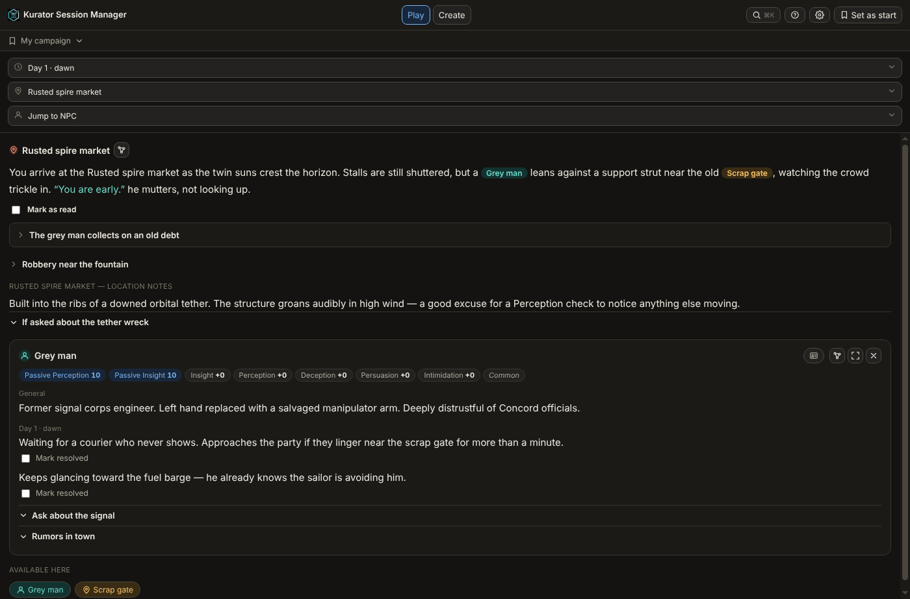
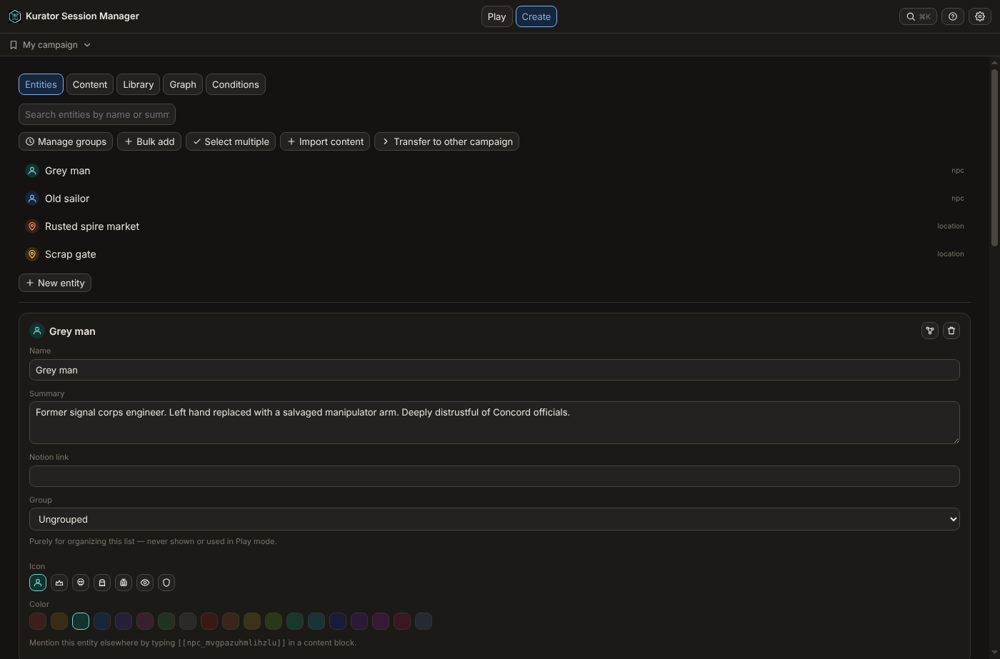
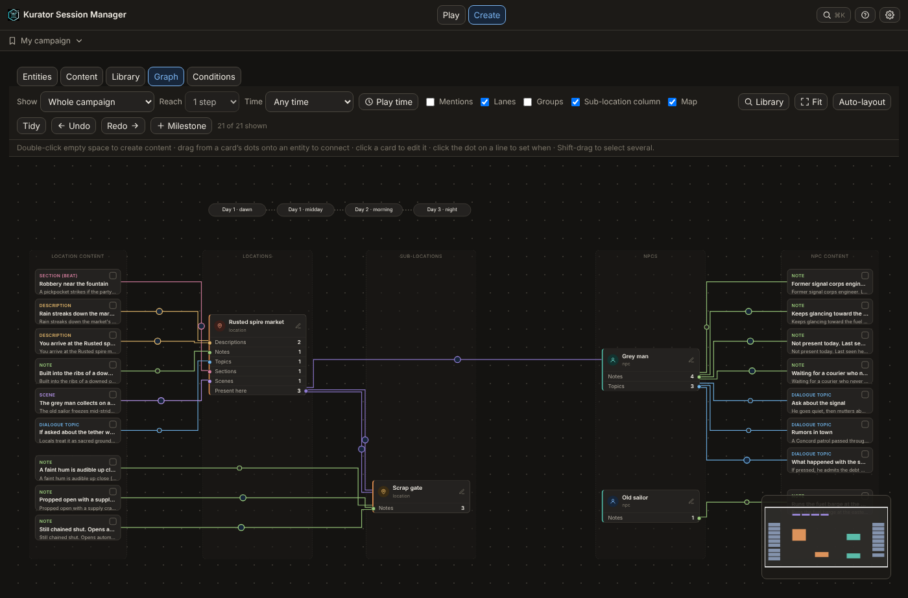
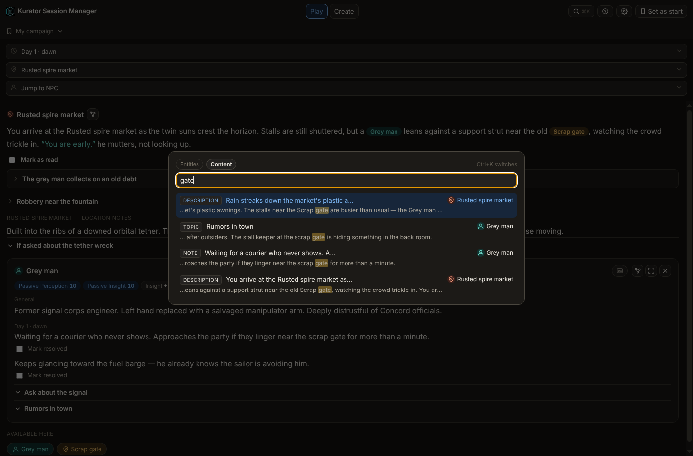

# Kurator Session Manager

This is a Session Notes Organizer for Dungeon Masters. 
A passion project that I (with lots of help of AI) created for my own homebrew DND campaign. 
You can create locations, NPCs, Dialog, Sections all based on "milestones" which you can use to track moments in time. For example "morning", "midday" etc. 
It can do much much more Check out the features for more details. 

You then have a dedicated "play" screen in which you can jump through your entities to read off without having to go crazy keeping track. 
There is a "mark as complete" checkbox that allows you to hide the note once it was read. 
If you didn't mark something it will come up on the next "milestone" in case you just missed it. 

There is also a nice connection to another Tool, that allows you to control playlists, soundeffects and even concept art if you have that. (optional)

## Features

- **Play mode** — jump to any location or NPC (`Ctrl+K`), see what is prepared for the current milestone,
  tick off beats and topics as they happen, hover any name or quote for a quick NPC card.
- **Milestones** — content appears when the story reaches it. Step with `Ctrl +` / `Ctrl -`.
- **Content search** — press `Ctrl+K` twice to search the text of everything you prepared and jump straight to it.
- **Create mode** — entities, content (descriptions, scenes, beats, notes, topics), a library, a visual graph,
  conditions and quests.
- **Character cards** — 2024-style stat block, voice and personality notes for every NPC.
- **DC checks** — roll tables with outcomes and conditions, nestable.
- **Artwork** — point it at a folder of images and new NPCs find their portrait by name
  ("Mira Selven" finds `MiraSelven.png`, `mira-selven.jpg`, …). THis helps me seeing the character I play to get into character a bit easier. 
- **Writing shortcuts** — `@` mentions, `""` dialogue, `Ctrl+L` links, `Ctrl+D` add DC Check, formatting, all in every text field.
- **Graph view** — see how your content, locations and NPCs connect, drag to rearrange, drag to connect.
- **Optional integrations** — control the Director music/scene tool, open Notion pages from entities.
- Everything is stored as plain JSON on your own computer. No account, no cloud.

| Create | Graph | Content search |
| --- | --- | --- |
|  |  |  |

## Install

### Easiest: the portable app (Windows)

1. Go to the [**Releases**](../../releases/latest) page and download `Kurator-Session-Manager-…-portable.exe`.
2. Put it in a folder of its own and double-click it. No installation, no Node.js, no npm.
3. Windows may warn that the app is from an unknown publisher (it is not code-signed). Click
   **More info → Run anyway**.

Your campaigns are saved in a `campaign-data` folder **next to the .exe**, together with `settings.json`.
Keep that folder to keep your campaigns; copy it to move to another computer.

### From source (Windows, macOS, Linux)

1. Install [Node.js](https://nodejs.org) (the LTS version).
2. Download or clone this repository and open a terminal in the folder.
3. `npm install`, then `npm start`. (On Windows you can also just double-click `start.bat`.)

Data is stored in `campaign-data/` inside the project folder.

## The example campaign

The first time the app starts it creates a small example campaign ("My campaign": a market, a gate, two NPCs,
scenes, topics and a few milestones) so you can see how everything fits together. You can edit or delete it
freely.

The same example is included as plain files in [`examples/campaign-data`](examples/campaign-data) — you can
read the JSON on GitHub, or copy that folder next to the app to start from the example again. **Careful:**
copying it over an existing `campaign-data` folder replaces your campaigns, so only do that for a fresh start.

## Optional setup (Settings, the gear icon)

- **Session prep folder / Director app folder** — for the scene, music and sound buttons that talk to the
  Director tool (details in the [development notes](docs/DEVELOPMENT-NOTES.md)).
- **Artwork default folder** — your portrait library for the automatic artwork lookup.
- **Notion** — to open an entity's Notion page in the desktop app, make sure `notionExePath` in
  `settings.json` points to your `Notion.exe` (the default is the standard Windows install location).

## Backups

The app keeps rolling backups inside each campaign folder, but a backup on the same disk is not a safe copy.
Copy `campaign-data` somewhere else now and then.

## Development

[`docs/DEVELOPMENT-NOTES.md`](docs/DEVELOPMENT-NOTES.md) holds the design notes and a change log per version.
The main commands:

| Command | What it does |
| --- | --- |
| `npm start` | run the app from source |
| `npm test` | run the unit tests |
| `npm run example` | regenerate `examples/campaign-data` |
| `npm run dist` | build the portable Windows exe into `release/` |

Releases are built automatically: publishing a release on GitHub starts
[`.github/workflows/build.yml`](.github/workflows/build.yml), which runs the tests, builds the exe and
attaches it to the release. Publishing steps for the maintainer are in [`docs/PUBLISHING.md`](docs/PUBLISHING.md).

## License

[MIT](LICENSE). Not affiliated with Wizards of the Coast; see [NOTICE.md](NOTICE.md) for the SRD 5.2
attribution and third-party notices.
